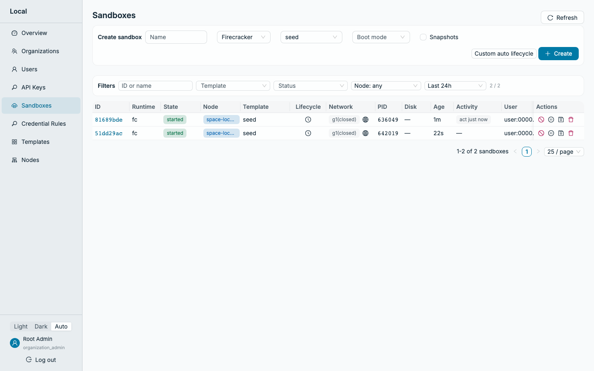
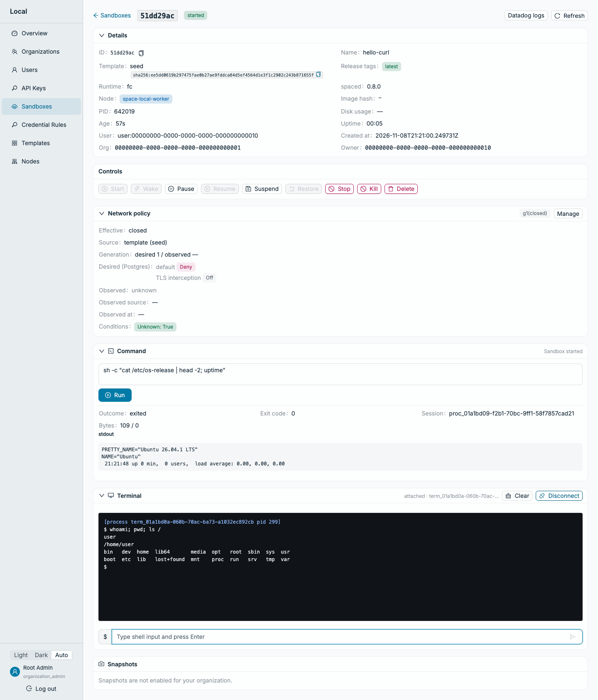

# Your first sandbox

Create a sandbox, run commands in it, pause, suspend and wake it, and delete it. Everything here runs on your Mac and reaches SPACE on the host through the tunnel, so start with [SETUP.md](SETUP.md) done and the tunnel up:

```bash
scripts/tunnel.sh <space-host> --status
```

Run the commands from this repo's root, in one terminal, in order. Each block is safe to paste as it is.

## Tour with `scripts/space`

`scripts/space` is a small CLI in this repo for SPACE's public API. It logs in as `root@local` by itself, keeps the token in `~/.space-on-kind/`, and takes a sandbox name, a full ID or a unique ID prefix. `scripts/space --help` lists its commands; every sandbox action in this doc, delete included, goes through it. [Under the hood](#under-the-hood-the-rest-api) shows the REST calls it makes.

### Create a sandbox

```bash
scripts/space create hello
scripts/space ls
```

```text
creating sbx_01a1dee8-dd68-7560-ba36-17888f99ba1c...
sbx_01a1dee8-dd68-7560-ba36-17888f99ba1c
ID                                        NAME        STATE    CREATED
sbx_01a1dee8-dd68-7560-ba36-17888f99ba1c  hello       running  2026-11-15T11:12:45Z
sbx_01a1be87-a823-76e7-b495-eefabe4febbf  hello-curl  running  2026-11-09T04:18:43Z
```

Creating takes a second or two. `create` prints the new sandbox's ID, so `SBX=$(scripts/space create hello)` captures it. `ls` lists every sandbox you have, so yours may show more.

### Run commands

`exec` runs a command in the sandbox, streams its output and exits with its exit code. Use `sh -c` for anything that needs a shell:

```bash
scripts/space exec hello -- sh -c 'uname -srm; . /etc/os-release; echo "$PRETTY_NAME"; nproc; free -m | head -2; df -h / | tail -1; id; hostname'
```

```text
Linux 6.1.155+ x86_64
Ubuntu 26.04.1 LTS
2
               total        used        free      shared  buff/cache   available
Mem:             985         118         922           0          39         867
/dev/root       438M  322M  102M  76% /
uid=2000(user) gid=2000(user) groups=2000(user)
space-sandbox
```

stdout and stderr stay separate, and the exit code comes back to your shell:

```bash
scripts/space exec hello -- sh -c 'echo to-stdout; echo to-stderr >&2; exit 3'; echo "exit=$?"
```

```text
to-stderr
to-stdout
exit=3
```

When stdout and stderr both go to the terminal, their order isn't guaranteed.

The sandbox has no network by default:

```bash
scripts/space exec hello -- curl -sS --max-time 5 https://example.com; echo "exit=$?"
```

```text
curl: (28) Resolving timed out after 5001 milliseconds
exit=28
```

Its network policy says why: egress is denied unless a rule allows it.

```bash
scripts/space policy hello
```

```text
{
  "version": "v1",
  "egress": {
    "default_action": "deny",
    "allow": [],
    "deny": []
  }
}
```

### What's inside

That output describes the sandbox you get from the `seed` template with default resources:

| Aspect | Value |
|---|---|
| Isolation | A Firecracker microVM with its own kernel, 6.1.155 |
| OS | Ubuntu 26.04.1 LTS, hostname `space-sandbox` |
| CPU and memory | 2 vCPUs, about 1 GB |
| Root disk | 438 MB, about 100 MB free |
| User | `user` (uid 2000), home `/home/user`, not root |
| Network | Closed: egress denied by default |

SPACE's docs cover [egress profiles](https://github.com/perplexityai/SPACE/blob/main/docs/egress-profiles.md) for opening the network.

### Watch it

Live resource and network counters:

```bash
scripts/space stats hello
```

```text
{
  "sandbox_id": "sbx_01a1dee8-dd68-7560-ba36-17888f99ba1c",
  "cpu_max": "200000 100000",
  "memory_max": 8724152320,
  "memory_current": 6107136,
  "pids_max": 256,
  "pids_current": 12,
  "cpu_usage_usec": 132627,
  "network_tx_bytes": 0,
  "network_rx_bytes": 0,
  "net_gateway_reachable": true,
  "tcp_active_connections": 0,
  "tcp_total_connections": 0,
  "tcp_denied_connections": 0,
  "udp_active_mappings": 0,
  "bytes_forwarded": 0
}
```

Running processes. Start a long one in the background, then list. Commands get a 30-second deadline unless you pass `--timeout`, so give this one ten minutes:

```bash
scripts/space exec --timeout 600s hello -- sleep 300 &
sleep 3
scripts/space ps hello
```

```text
[2] 53178
PROCESS                                    PID  COMMAND
proc_01a1dee9-f59b-75ed-b528-cea184971a5a  310  sleep 300
```

Kill it. The background `exec` exits with 137, the code for a killed process:

```bash
scripts/space kill hello "$(scripts/space ps hello | awk 'NR == 2 {print $1}')"
wait $!; echo "exit=$?"
```

```text
killed proc_01a1dee9-f59b-75ed-b528-cea184971a5a
[2]  + exit 137   scripts/space exec --timeout 600s hello -- sleep 300
exit=137
```

zsh also prints its own job lines, `[2] 53178` and `[2]  + exit 137 …` here; bash prints similar ones. A command that outlives its deadline is stopped too, and exits with 124.

### Pause and resume

Pause freezes the VM's vCPUs. The VM stays on its node with its memory, so it frees nothing, and nothing runs until you resume. `exec` refuses to run in a paused sandbox:

```bash
scripts/space pause hello
scripts/space exec hello -- true
scripts/space resume hello
```

```text
sbx_01a1dee8-dd68-7560-ba36-17888f99ba1c: paused
space: sbx_01a1dee8-dd68-7560-ba36-17888f99ba1c is paused; run: space resume sbx_01a1dee8-dd68-7560-ba36-17888f99ba1c
sbx_01a1dee8-dd68-7560-ba36-17888f99ba1c: running
```

### Suspend and wake

Suspend saves the whole VM, memory included, and takes it off the node; wake brings it back. Write a file and note the kernel's boot ID, which changes whenever the VM boots, then suspend:

```bash
scripts/space exec hello -- sh -c 'echo before-suspend > /home/user/marker; cat /proc/sys/kernel/random/boot_id'
scripts/space suspend hello
scripts/space exec hello -- true
```

```text
0dc9b21a-2c99-4406-a32f-354c78c9f1f6
sbx_01a1dee8-dd68-7560-ba36-17888f99ba1c: suspended
space: sbx_01a1dee8-dd68-7560-ba36-17888f99ba1c is suspended; run: space wake sbx_01a1dee8-dd68-7560-ba36-17888f99ba1c
```

Wake it and look again:

```bash
scripts/space wake hello
scripts/space exec hello -- sh -c 'cat /home/user/marker; cat /proc/sys/kernel/random/boot_id'
```

```text
sbx_01a1dee8-dd68-7560-ba36-17888f99ba1c: running
before-suspend
0dc9b21a-2c99-4406-a32f-354c78c9f1f6
```

The file survived and the boot ID didn't change: wake restored the same running VM instead of booting a new one.

Wake a suspended sandbox; don't resume it. `resume` only unfreezes a paused one. The API doesn't refuse `resume` on a suspended sandbox: it restores it through a slower recovery path, which took about 84 s against 2.4 s for `wake`, with nothing on screen. So `scripts/space resume` checks first and stops with `... is suspended, not paused; ... Wake it instead: space wake <id>`.

### Where a suspended sandbox goes

There's no AWS here. Suspend writes the VM to an S3-compatible object store that runs inside the KinD cluster: [Versity S3 Gateway](https://github.com/versity/versitygw) (`versitygw`), deployed by SPACE's `space-object-store` chart (`infra/space/kind/charts/space-object-store`). It's a real S3 API that checks SigV4 signatures, and production's code talks to it unchanged: the sandbox's node uploads the snapshot with the same object-store crate it uses against S3, pointed at this endpoint instead. It listens on port 8333, which `scripts/tunnel.sh` forwards as "Object storage".

Its backend is plain files. Each bucket is a directory and each object is a file, with the object's metadata in extended attributes. They live under `/var/lib/space-object-store` on the KinD node that runs the gateway, which is a Docker volume on the Linux host, not on your Mac. There are two buckets:

- `snapshots`: suspend snapshots.
- `templates`: template releases, such as `seed`.

Every suspend gets its own directory, so a new suspend never overwrites an older one:

```text
snapshots/suspend_snapshots/<shard>/<sandbox id>/<snapshot id>/
```

`<shard>` is two hex digits computed from the sandbox ID. On S3 it spreads uploads across key prefixes, and on KinD it's just another directory level. The sandbox ID has no `sbx_` prefix here, and the snapshot ID is a fresh UUIDv7 for each attempt. Each directory holds four files, all compressed with zstd:

| File | What it is |
| --- | --- |
| `memfile` | the guest's memory |
| `binfile` | Firecracker's VM state: CPU registers and devices |
| `rootfs.btrfs-send` | the root filesystem's changes since the template, as an incremental `btrfs send` stream |
| `metadata.json` | what the snapshot was taken from: Firecracker and kernel versions, template, sizes, owner |

A 1 GiB VM that had done little came to about 30 MiB, most of it `memfile`.

#### Look inside the object store

You need the AWS CLI and zstd on the Mac, which `scripts/mac-install.sh` installs, and the tunnel up. The gateway's credentials are the dev-only root keys from the chart, and the region is `us-east-1`:

```bash
export AWS_ACCESS_KEY_ID=localadmin AWS_SECRET_ACCESS_KEY=localadmin-dev-secret AWS_DEFAULT_REGION=us-east-1
unset AWS_PROFILE AWS_SESSION_TOKEN
vgw() { aws --endpoint-url http://127.0.0.1:8333 "$@"; }

vgw s3 ls
vgw s3 ls s3://snapshots/suspend_snapshots/ --recursive --human-readable
```

```text
2026-11-09 02:34:58 snapshots
2026-10-24 21:45:41 templates
2026-11-15 23:58:51    2.5 KiB suspend_snapshots/14/01a1be87-a823-76e7-b495-eefabe4febbf/01a1e35d-b2a3-71d1-8a28-2f3b251f1434/binfile
2026-11-15 23:58:52   29.4 MiB suspend_snapshots/14/01a1be87-a823-76e7-b495-eefabe4febbf/01a1e35d-b2a3-71d1-8a28-2f3b251f1434/memfile
2026-11-15 23:58:52  810 Bytes suspend_snapshots/14/01a1be87-a823-76e7-b495-eefabe4febbf/01a1e35d-b2a3-71d1-8a28-2f3b251f1434/metadata.json
2026-11-15 23:58:51   92.4 KiB suspend_snapshots/14/01a1be87-a823-76e7-b495-eefabe4febbf/01a1e35d-b2a3-71d1-8a28-2f3b251f1434/rootfs.btrfs-send
```

To see only one sandbox's snapshots, filter on its ID without the `sbx_` prefix: `... --recursive | grep 01a1be87`.

Read a snapshot's metadata. It's compressed, so pipe it through `zstd -dc` before `jq`:

```bash
vgw s3 cp s3://snapshots/suspend_snapshots/14/01a1be87-a823-76e7-b495-eefabe4febbf/01a1e35d-b2a3-71d1-8a28-2f3b251f1434/metadata.json - \
  | zstd -dc | jq '{sandbox_id, created_at, size_bytes, rootfs_size_bytes, runtime: .execution.runtime, template: .source.template_id}'
```

```json
{
  "sandbox_id": "01a1be87-a823-76e7-b495-eefabe4febbf",
  "created_at": "2026-11-16T07:58:51.021426846Z",
  "size_bytes": 1077074572,
  "rootfs_size_bytes": 3310741,
  "runtime": {
    "kind": "firecracker",
    "version": "1.15.1"
  },
  "template": "seed"
}
```

#### Look at the files on disk

The same objects are plain files in the gateway's pod, where the hostPath is mounted at `/data`:

```bash
kubectl exec deploy/space-object-store -n space --kubeconfig ~/.kube/space-on-kind.yaml --context kind-space-local -- \
  ls -la /data/snapshots/suspend_snapshots/14/01a1be87-a823-76e7-b495-eefabe4febbf/01a1e35d-b2a3-71d1-8a28-2f3b251f1434
```

```text
-rw-r--r--    1 root     root          2518 Nov 16 07:58 binfile
-rw-r--r--    1 root     root      30857539 Nov 16 07:58 memfile
-rw-r--r--    1 root     root           810 Nov 16 07:58 metadata.json
-rw-r--r--    1 root     root         94631 Nov 16 07:58 rootfs.btrfs-send
```

`/data` also holds the `templates` bucket and two dot-directories that aren't buckets: `.iam`, the gateway's IAM state, and `.vgwlocks`, its lock files. Browse, but don't edit or delete anything here by hand. The database still points at these objects, and the next wake will look for them.

### Idle sandboxes suspend themselves

A sandbox that sees no access and no commands for 6 hours suspends itself. If you come back to one later, wake it first: `exec` tells you when it's suspended. You can choose another idle timeout, and whether idling ends in `suspend` or `delete`, when you create a sandbox:

```bash
scripts/space create lazy --idle-timeout 15m > /dev/null
scripts/space get lazy | jq '{name, idle_timeout, idle_action}'
scripts/space rm lazy
```

```text
creating sbx_01a1deea-fbcd-753c-bad0-5670a89ee552...
{
  "name": "lazy",
  "idle_timeout": "900s",
  "idle_action": "suspend"
}
deleted sbx_01a1deea-fbcd-753c-bad0-5670a89ee552
```

The sandbox-manager on the sandbox's node enforces the policy, checking every 5 seconds for sandboxes past their deadline.

### Delete it

```bash
scripts/space rm hello
```

```text
deleted sbx_01a1dee8-dd68-7560-ba36-17888f99ba1c
```

## Under the hood: the REST API

`scripts/space` is a thin layer over SPACE's REST API. Two of its patterns are worth seeing by hand; everything else follows them. Log in first, to get a token:

```bash
export SPACE_API_URL=http://127.0.0.1:8080
export SPACE_DATA_PLANE_URL=http://127.0.0.1:8090
export SPACE_API_TOKEN="$(jq -nc '{email: "root@local", password: "password"}' | curl -s -H 'Content-Type: application/json' --data-binary @- "$SPACE_API_URL/auth/v1/sessions" | jq -r .token)"
```

### Create, wait, get

Creating a sandbox returns an operation, not a sandbox. Mutations take an `Idempotency-Key`: retrying with the same key and body returns the original result instead of creating a second sandbox.

```bash
created=$(jq -nc '{template: "seed:latest", runtime: "fc", name: "hello-rest"}' | curl -s -H "Authorization: Bearer $SPACE_API_TOKEN" -H 'Content-Type: application/json' -H "Idempotency-Key: create-$(uuidgen)" --data-binary @- "$SPACE_API_URL/v1/sandboxes")
echo "$created" | jq .
SBX=$(echo "$created" | jq -r .sandbox_id)
OP=$(echo "$created" | jq -r .operation_id)
```

```text
{
  "operation_id": "op_01a1deeb-8b48-7650-8113-b999248ec619",
  "sandbox_id": "sbx_01a1deeb-8b47-71a2-9fd1-e69358f67b4c"
}
```

Poll the operation until its `state` is `succeeded`. Run this again if it isn't yet:

```bash
curl -s -H "Authorization: Bearer $SPACE_API_TOKEN" "$SPACE_API_URL/v1/operations/$OP" | jq '{kind, state}'
```

```text
{
  "kind": "create_sandbox",
  "state": "succeeded"
}
```

Then get the sandbox:

```bash
curl -s -H "Authorization: Bearer $SPACE_API_TOKEN" "$SPACE_API_URL/v1/sandboxes/$SBX" | jq '{id, name, state, template, idle_timeout, idle_action}'
```

```text
{
  "id": "sbx_01a1deeb-8b47-71a2-9fd1-e69358f67b4c",
  "name": "hello-rest",
  "state": "running",
  "template": "seed",
  "idle_timeout": "21600s",
  "idle_action": "suspend"
}
```

Suspend, wake, pause, resume and delete work the same way: `POST /v1/sandboxes/{id}:suspend` (or `:wake`, `:pause`, `:resume`) and `DELETE /v1/sandboxes/{id}` each return an operation to poll.

### Run a command

Running a command takes two requests. The first, to the API, creates a command session. It returns the session's event-stream URL and a token for that stream only; it isn't your API token:

```bash
cmd=$(jq -nc '{command: ["uname", "-srm"], timeout: "30s"}' | curl -s -H "Authorization: Bearer $SPACE_API_TOKEN" -H 'Content-Type: application/json' -H "Idempotency-Key: cmd-$(uuidgen)" --data-binary @- "$SPACE_API_URL/v1/sandboxes/$SBX/commands")
echo "$cmd" | jq '{session_id, events_url: .attach.events_url}'
```

```text
{
  "session_id": "proc_01a1deec-0343-7796-806c-17da52ec1ad1",
  "events_url": "/v1/sessions/proc_01a1deec-0343-7796-806c-17da52ec1ad1/events"
}
```

The second attaches to that stream on the data plane (port 8090), which starts the process. This saves the stream to `events.sse` and prints it:

```bash
curl -sN -H "Authorization: Bearer $(echo "$cmd" | jq -r .attach.token)" -H 'Accept: text/event-stream' "$SPACE_DATA_PLANE_URL$(echo "$cmd" | jq -r .attach.events_url)" > events.sse
cat events.sse
```

```text
event: attached
data: {"type":"attached","session_id":"proc_01a1deec-0343-7796-806c-17da52ec1ad1","route_generation":2,"current_node_id":"2d4303a9-4fcd-5bac-854b-23847b0df036"}

event: process_started
data: {"type":"process_started","process_id":"proc_01a1deec-0343-7796-806c-17da52ec1ad1","pid":293}

event: stdout
data: {"type":"stdout","seq":1,"data_base64":"TGludXggNi4xLjE1NSsgeDg2XzY0Cg=="}
id: 4503599627632640

event: process_exited
data: {"type":"process_exited","process_id":"proc_01a1deec-0343-7796-806c-17da52ec1ad1","exit_code":0,"status":"exited"}

event: closed
data: {"type":"closed","reason":"backend_closed"}
```

Output arrives as server-sent events, one `stdout` or `stderr` event per chunk, base64-encoded. Decode it:

```bash
sed -n 's/^data: //p' events.sse | jq -rj 'if .type == "stdout" or .type == "stderr" then (.data_base64 | @base64d) elif .type == "process_exited" then "[exit_code=\(.exit_code)]\n" else empty end'
```

```text
Linux 6.1.155+ x86_64
[exit_code=0]
```

A closed stream alone doesn't mean success: check for `process_exited` and its `exit_code`. If the sandbox isn't running, the first request still succeeds, but the stream answers `not_ready` or `stream_unavailable` instead; `scripts/space exec` checks the sandbox's state first to tell you why.

Delete the sandbox when you're done:

```bash
scripts/space rm hello-rest
```

```text
deleted sbx_01a1deeb-8b47-71a2-9fd1-e69358f67b4c
```

## SPACE's own example

SPACE ships a [first-sandbox example](https://github.com/perplexityai/SPACE/blob/main/examples/first_sandbox.py) that creates a sandbox, runs `Hello from SPACE`, inspects the result and offers to delete it. SPACE's [guide](https://github.com/perplexityai/SPACE/blob/main/docs/first-sandbox.md) runs it on the Linux host, where the API and data plane are on loopback. The tunnel puts them on loopback on your Mac too, and the script is standard-library Python that accepts plain HTTP to loopback, so it also runs unchanged on the Mac. That's not something SPACE documents; this repo tested it. Copy it from the host's checkout, so it matches the SPACE version you installed:

```bash
ssh <space-host> cat SPACE/examples/first_sandbox.py > first_sandbox.py
python3 first_sandbox.py
```

It reads `SPACE_API_URL`, `SPACE_DATA_PLANE_URL` and `SPACE_API_TOKEN` from the environment you just set. A run looks like this (inspection output trimmed):

```
Run directory: /var/folders/.../space-first-sandbox-srimbvad
sandbox_id: sbx_01a1bd08-9929-7720-a11a-06cb81689bde
operation_id: op_01a1bd08-992d-7693-ab2a-90ccb4680b58
session_id: proc_01a1bd08-a099-720f-9740-30c68fef5d74
process_id: proc_01a1bd08-a099-720f-9740-30c68fef5d74
Event transcript: /var/folders/.../space-first-sandbox-srimbvad/events-xaawwnfn.sse
Hello from SPACE
Command completed successfully: proc_01a1bd08-a099-720f-9740-30c68fef5d74
...
Delete sbx_01a1bd08-9929-7720-a11a-06cb81689bde and remove its event transcripts? [y/N]
```

The whole run took about 3 seconds, and the sandbox was up in under one. Answer `y` to delete it, or keep it and delete it later with `python3 first_sandbox.py delete <run directory>`. SPACE's [Your first sandbox](https://github.com/perplexityai/SPACE/blob/main/docs/first-sandbox.md) guide explains every step and how to change the command.

## In the UI

Open <http://127.0.0.1:3000> and go to **Sandboxes**. It lists every sandbox with its runtime, state, node and age, and has a form to create one:



Click a sandbox for its details. The page has lifecycle controls (pause, suspend, stop, kill, delete), the network policy, a **Command** box that runs a command and shows its output, and a **Terminal** for an interactive shell inside the VM:



## Where to look

| To see | Use |
|---|---|
| A sandbox's state, template and lifecycle settings | `scripts/space get <sandbox>`, or the UI's sandbox page |
| Live CPU, memory, process and network counters | `scripts/space stats <sandbox>` |
| Running processes | `scripts/space ps <sandbox>` |
| The effective network policy | `scripts/space policy <sandbox>`, or the UI's sandbox page |
| An operation's progress or error | `GET /v1/operations/{id}` |

## Where next

- SPACE's [API reference](https://github.com/perplexityai/SPACE/blob/main/docs/api/index.md) has the rest: files, ports, processes, network policies and snapshots.
- The [E2B Compatibility Wrapper](https://github.com/perplexityai/SPACE/blob/main/docs/ecw.md) points an existing E2B client at SPACE.
