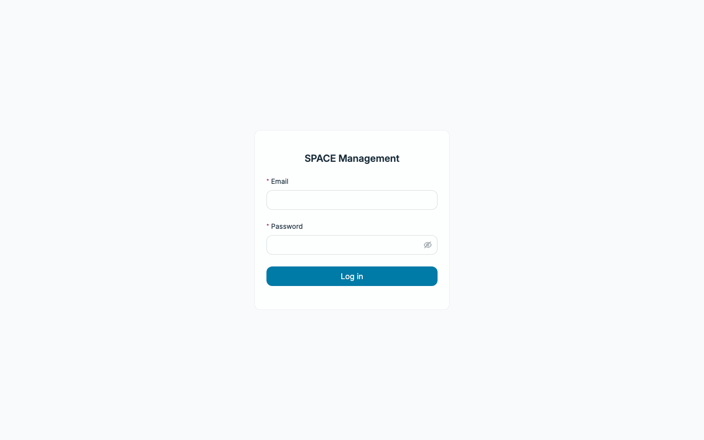
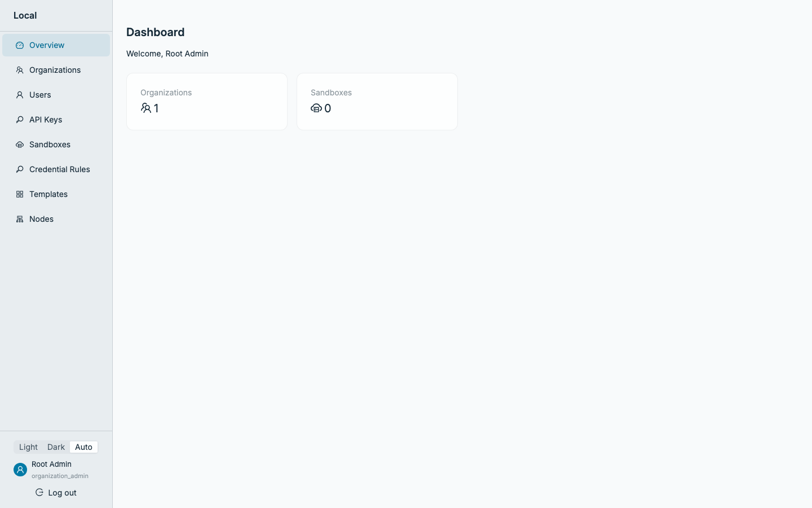
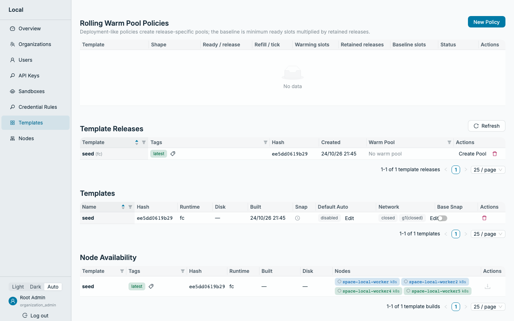
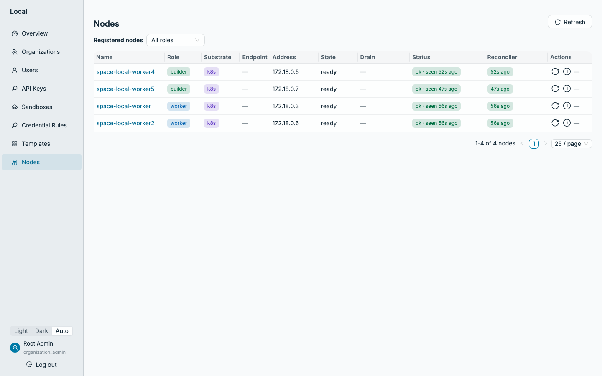
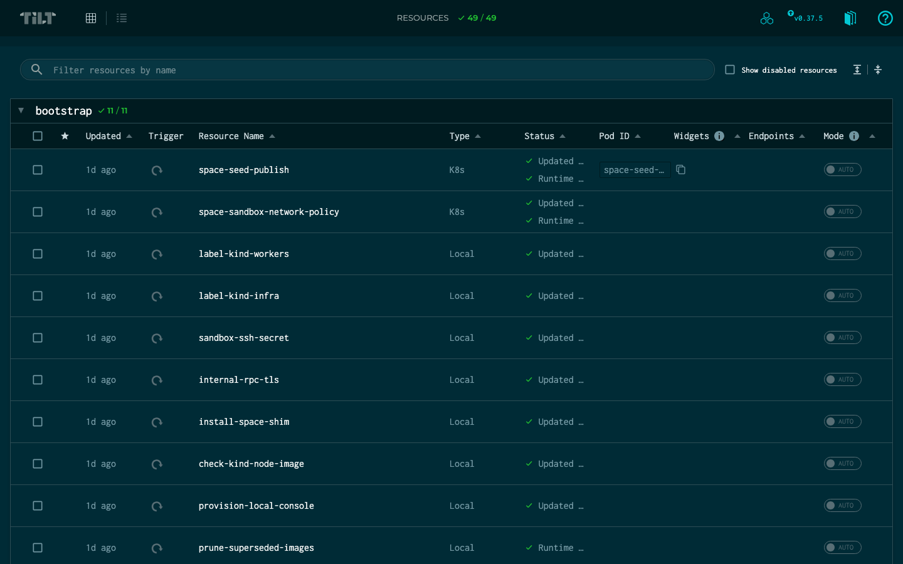

# Setup

Get a Linux host, install SPACE on it, connect your Mac, and look around. Creating and using a sandbox comes next, in its own doc.

This repo is for **macOS**. [SPACE](https://github.com/perplexityai/SPACE) itself can't run on a Mac, so the setup has two parts:

- **A Linux host** runs [Docker](https://www.docker.com/), [KinD](https://kind.sigs.k8s.io/) and SPACE.
- **Your Mac** talks to it over ssh: [kubectl](https://kubernetes.io/docs/reference/kubectl/), port forwards, and a browser for the UI.

## Why not run it all on the Mac?

SPACE runs every sandbox in a [Firecracker](https://firecracker-microvm.github.io/) microVM, inside a KinD node, inside Docker. Firecracker needs [KVM](https://linux-kvm.org/), and SPACE's local setup only supports x86_64. A Mac can't provide both:

- [Docker Desktop](https://www.docker.com/products/docker-desktop/), [Colima](https://github.com/abiosoft/colima), [Rancher Desktop](https://rancherdesktop.io/) and [OrbStack](https://orbstack.dev/) all run Docker in a Linux VM. On Apple Silicon that VM is arm64.
- Colima and [UTM](https://getutm.app/) can turn on nested virtualization on M3 or newer chips, but the `/dev/kvm` you get is arm64, not x86_64.
- UTM can emulate x86_64, but that's software emulation ([QEMU](https://www.qemu.org/) TCG) with no usable KVM. It would also be far too slow to build SPACE.

So you don't need Docker, KinD or [Tilt](https://tilt.dev/) on the Mac. All three live on the Linux host. SPACE's prerequisite installer puts KinD, kubectl, [Helm](https://helm.sh/) and Tilt on the host, and its bring-up runs `tilt up` there in the background to build images and deploy charts. You watch it from the Mac in the Tilt UI at `http://127.0.0.1:10350`, which `scripts/tunnel.sh` forwards.

## 1. Get a Linux host

The host needs:

- Linux on **x86_64**, preferably apt-based ([Ubuntu](https://ubuntu.com/) or [Debian](https://www.debian.org/))
- **`/dev/kvm`** that your user can read and write: bare metal, or a VM with nested virtualization
- `/dev/net/tun`, loop devices and [btrfs](https://btrfs.readthedocs.io/) support (standard on mainstream kernels)
- Docker that allows privileged containers
- Non-interactive sudo, so SPACE's installer can add system packages
- At least **30 GiB free** for Docker's data root and for your home directory. 100 GiB is more comfortable.
- 8+ CPUs and 32 GiB RAM recommended. The first bring-up compiles SPACE's Rust workspace.

Where to get one:

| Option | Notes |
|---|---|
| **A Linux machine you own** | Any x86_64 desktop, laptop or mini PC with virtualization (VT-x / AMD-V) enabled in the BIOS. Ubuntu 24.04 LTS is the smoothest. Free if you have one. |
| **[GCP Compute Engine](https://cloud.google.com/products/compute)** | An Intel machine type such as `n2-standard-8`, created with `--enable-nested-virtualization` ([docs](https://docs.cloud.google.com/compute/docs/instances/nested-virtualization/enabling)). E2 machine types (including the free-tier `e2-micro`) and AMD types don't support nested virtualization. Stop the VM between sessions to stop paying for compute. |
| **[AWS EC2](https://aws.amazon.com/ec2/)** | Intel instances (for example `c8i` or `m8i`) launched with `--cpu-options NestedVirtualization=enabled`, or any `.metal` instance. Check that your instance type and region support it. |
| **[Hetzner dedicated (AX line)](https://www.hetzner.com/dedicated-rootserver/matrix-ax/)** | A physical server, so KVM is native. Billed monthly; a good fit if you'll keep it running. |

Free cloud tiers don't fit: they're too small, and they lack nested virtualization or x86_64.

### What about Omarchy (or another Arch-based distro)?

[Omarchy](https://omarchy.org/), which is based on [Arch Linux](https://archlinux.org/), works with a few manual steps on an x86_64 machine. SPACE's guide targets apt-based hosts, but its installer only uses apt for a few small packages and downloads everything else itself. On Omarchy:

- Install the packages SPACE would have taken from apt: `sudo pacman -S --needed jq lsof unzip`
- Docker comes preinstalled. Give your user access: Omarchy's Setup > Security > Sudoless Docker, or `sudo usermod -aG docker $USER`
- Give your user KVM access: `sudo usermod -aG kvm $USER`. Then log out and back in.
- Omarchy's root filesystem is btrfs with snapshots. Docker's data and KinD's `~/.kind-data` can grow by tens of GiB, so exclude them from snapshots, or you'll lose disk to snapshot copies.

Non-apt hosts are outside what SPACE's guide covers. If something breaks there, try an Ubuntu host before filing a bug.

### Set up ssh

All of this happens on the Mac. The scripts reach the host with plain `ssh <name>`, so you need a key the host accepts and an entry in `~/.ssh/config`.

**Get a key.** Skip this if you already ssh to the host with a key. Otherwise create one for it:

```bash
ssh-keygen -t ed25519 -f ~/.ssh/space-host -C space-on-kind
```

The private key stays in `~/.ssh/space-host`. The host gets the public half, `~/.ssh/space-host.pub`:

| Host | How to install the public key |
|---|---|
| Your own Linux machine | `ssh-copy-id -i ~/.ssh/space-host.pub <user>@<host>` (needs password login once) |
| GCP | `gcloud compute ssh <vm> --zone <zone>` creates and installs its own key, `~/.ssh/google_compute_engine`. Use that as the `IdentityFile`, or add yours under the VM's or project's SSH keys metadata |
| AWS | Import it as an EC2 key pair (`aws ec2 import-key-pair --key-name space-host --public-key-material fileb://~/.ssh/space-host.pub`) and pick that key pair at launch. The user is `ubuntu` on Ubuntu AMIs |
| Hetzner | Add it under SSH keys in the Robot console before you order or reinstall, and it lands in `root`'s `authorized_keys` |

**Add the host** to `~/.ssh/config` so the scripts can refer to it by name:

```
Host space-host
    HostName <ip-or-dns-name>
    User <your-user>
    IdentityFile ~/.ssh/space-host
    IdentitiesOnly yes
    ServerAliveInterval 15
```

Check it with `ssh space-host true`. It should return without asking for a password.

## 2. Install

One command on the Mac does everything:

```bash
scripts/install.sh --space-host space-host
```

You can set `SPACE_HOST=space-host` instead of passing `--space-host`. The script:

1. **Installs the Mac tools.** `scripts/mac-install.sh` installs `kubectl` and [`jq`](https://jqlang.org/) if they aren't already on your `PATH`, using [Homebrew](https://brew.sh). Tools you installed some other way count, and Homebrew is only needed if something is missing. `ssh` and `curl` ship with macOS.
2. **Checks ssh.** It stops if the host can't be reached without a password prompt.
3. **Copies `scripts/host-install.sh`** to `~/.space-on-kind/` on the host.
4. **Runs it on the host.** `host-install.sh` checks every host prerequisite first: platform, devices, tools, Docker and free disk, plus one throwaway privileged container. If anything fails, it stops before installing anything and tells you what to fix. Then it does what SPACE's [install guide](https://github.com/perplexityai/SPACE/blob/main/docs/installation.md) describes:
   1. Clones SPACE into `~/SPACE`, or uses the checkout already there
   2. Installs KinD, kubectl, Helm, Tilt, Go and the rest with SPACE's prerequisite installer
   3. Stages Firecracker and the guest kernel
   4. Creates the KinD cluster and brings SPACE up under Tilt
   5. Verifies the seed template, the node services, the API and a `root@local` login

The first run compiles SPACE's Rust workspace, so it takes a while. On the host, the install runs inside a [tmux](https://github.com/tmux/tmux) session called `space-install`, so a dropped ssh connection doesn't kill it. Rerun the same command to get back to it.

Every step is safe to rerun: installed tools are kept and a running stack is reused. To run only the host checks, add `--check-only`. `scripts/install.sh --help` lists the settings it passes through to the host.

## 3. Connect from the Mac

```bash
scripts/tunnel.sh space-host
```

This forwards SPACE's ports from the host to `127.0.0.1` on the Mac, and forwards KinD's API server too:

| Port | Service |
|---|---|
| 8080 | API |
| 8090 | Data plane (command output streams) |
| 3000 | UI |
| 8333 | Object storage |
| 10350 | Tilt UI |
| random | KinD API server, through `~/.kube/space-on-kind.yaml` |

Rerunning it is safe. Stop it with `scripts/tunnel.sh space-host --stop`.

Check that every endpoint answers through the tunnel:

```
$ scripts/tunnel.sh space-host --status
[tunnel] tunnel to space-host is up; checking endpoints:
[tunnel]   ok    API             http://127.0.0.1:8080/healthz
[tunnel]   ok    Data-plane      http://127.0.0.1:8090/healthz
[tunnel]   ok    UI              http://127.0.0.1:3000/login
[tunnel]   ok    Object-storage  http://127.0.0.1:8333/healthz
[tunnel]   ok    Tilt-UI         http://127.0.0.1:10350/
[tunnel]   ok    KinD-API        kubectl --kubeconfig /Users/you/.kube/space-on-kind.yaml
[tunnel] all endpoints answer
```

It exits non-zero if the tunnel is down or any endpoint fails.

## 4. Look around

Everything below runs on the Mac, through the tunnel. None of it creates a sandbox.

### The UI

Open <http://127.0.0.1:3000> and log in as `root@local`. The password is `password` unless you set `SPACE_CONSOLE_PASSWORD` before installing.



The dashboard counts organizations and sandboxes. A fresh install has one organization, `Local`, and no sandboxes:



**Templates** shows the `seed` template the install published. That's a minimal Ubuntu image, and every sandbox you create starts from a template:



**Nodes** lists the KinD workers that run sandboxes (`worker`) and build templates (`builder`), each reporting in about once a minute:



### The API

Point a shell at the API and log in. The login returns a bearer token for management requests:

```bash
export SPACE_API_URL=http://127.0.0.1:8080
export SPACE_API_TOKEN="$(
  jq -nc '{email: "root@local", password: "password"}' |
    curl -s -H 'Content-Type: application/json' --data-binary @- \
      "$SPACE_API_URL/auth/v1/sessions" |
    jq -r .token
)"
```

Health and the API's own description don't need the token:

```
$ curl -s $SPACE_API_URL/healthz
ok

$ curl -s $SPACE_API_URL/openapi.json | jq '{title: .info.title, version: .info.version, paths: (.paths | length)}'
{
  "title": "SPACE API",
  "version": "0.8.0",
  "paths": 47
}
```

Everything else does. Who you are:

```
$ curl -s -H "Authorization: Bearer $SPACE_API_TOKEN" $SPACE_API_URL/auth/v1/me |
    jq '{email: .user.email, role: .user.role, org: .org.name, substrate}'
{
  "email": "root@local",
  "role": "organization_admin",
  "org": "Local",
  "substrate": "k8s"
}
```

The templates you can create sandboxes from:

```
$ curl -s -H "Authorization: Bearer $SPACE_API_TOKEN" $SPACE_API_URL/v1/templates |
    jq '.data[] | {name, description, variants: [.variants[] | {reference, runtime, arch, artifact_size_bytes}]}'
{
  "name": "seed",
  "description": "Minimal Ubuntu Firecracker seed (local build)",
  "variants": [
    {
      "reference": "seed@sha256:ee5dd0619b297475fae0b27ae9fddca84d5ef4564d1e3f1c2902c243b871655f",
      "runtime": "firecracker",
      "arch": "x86_64",
      "artifact_size_bytes": 472432640
    }
  ]
}
```

Your sandboxes (none yet):

```
$ curl -s -H "Authorization: Bearer $SPACE_API_TOKEN" "$SPACE_API_URL/v1/sandboxes?limit=10" | jq .
{
  "data": [],
  "next_cursor": null
}
```

The nodes, through the admin API:

```
$ curl -s -H "Authorization: Bearer $SPACE_API_TOKEN" $SPACE_API_URL/admin/api/v1/nodes |
    jq -r '.[] | [.name, .role, .state, .sandboxes_active] | @tsv' | sort | column -t
space-local-worker   worker   ready  0
space-local-worker2  worker   ready  0
space-local-worker4  builder  ready  0
space-local-worker5  builder  ready  0
```

Without a token, you get the API's standard error envelope:

```
$ curl -s $SPACE_API_URL/v1/sandboxes | jq -c .
{"code":"unauthorized","message":"Missing or invalid Authorization header","request_id":"req_...","retryable":false,"details":[]}
```

The full API is in SPACE's [API reference](https://github.com/perplexityai/SPACE/blob/main/docs/api/index.md).

### Tilt

<http://127.0.0.1:10350> is Tilt's view of the bring-up: every image it built and every resource it deployed. Tilt keeps running on the host and redeploys anything that changes in the SPACE checkout there.



### kubectl

The tunnel wrote a kubeconfig for the KinD cluster:

```
$ kubectl get pods -n space --kubeconfig ~/.kube/space-on-kind.yaml --context kind-space-local
NAME                                       READY   STATUS      RESTARTS   AGE
space-admin-api-f7768df76-fwrlj            1/1     Running     0          25h
space-api-7cb9756c9c-bf88l                 1/1     Running     0          25h
space-api-7cb9756c9c-bjz5h                 1/1     Running     0          25h
space-builder-build-manager-2d4kf          1/1     Running     0          25h
...
```

SPACE runs as about 60 pods: Deployments for the API and control plane, a StatefulSet for Postgres, and one DaemonSet per node service on the worker and builder nodes, as in production. To see them all:

```bash
kubectl get deploy,statefulset,daemonset,job -n space --kubeconfig ~/.kube/space-on-kind.yaml --context kind-space-local
```
